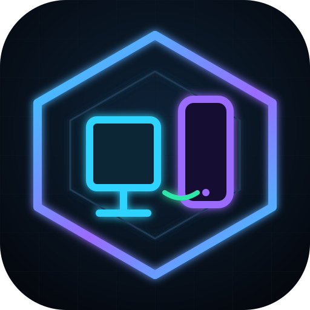

<div align="center">
  
  <h1>POLYFORGE · 跨平台应用转换器</h1>
  <p><b>Cross-Platform App Converter</b></p>
  <p>
    Windows ⇄ Android ⇄ Linux 任意格式互转 · 源码语言识别 · 二进制还原
  </p>
</div>

---

## 下载 / Download

| 平台 | 文件 |
| --- | --- |
| Windows 10/11 x64（免安装） | [POLYFORGE-2.0.0-Windows-x64.exe](../../releases/latest) |
| Android 7.0+ | [POLYFORGE-2.0.0-Android.apk](../../releases/latest) |

> 所有文件均在浏览器 / 设备本地解析与构建，**不会上传任何项目文件**。

<details>
<summary>SHA-256 校验 / Checksums</summary>

```
1041ecaf6816c2561a46290e5146855a075f578145717f0099794ece6fb5297a  POLYFORGE-2.0.0-Android.apk
425c9beb64d769e9ade3c04439620aa197c3af4ede87b2089a7d06d0723b2da4  POLYFORGE-2.0.0-Windows-x64.exe
```

</details>

## 功能 / Features

- **源码语言识别**：上传文件或整个文件夹，基于扩展名矩阵、内容签名与二进制魔数三重判定，识别 30+ 种语言、18 类框架（WPF、WinForms、.NET、Android、Flutter、Electron、Tauri、Unity、Qt…），输出置信度、语言分布与逐文件依据。
- **新增 Linux 与 MSI 支持**：可上传 Linux 可执行文件（ELF / AppImage）、Debian 包（.deb）、RPM 包、Snap（SquashFS）以及 Windows 安装包（.msi / .msix / .appx），自动识别格式并解析产品名与版本线索。
- **任意选择最终文件格式（2.0 核心）**：转换面板列出 6 种输出 —— **APK / EXE / DEB 三种可直接安装或运行的真实产物**，以及 Android / Windows / Flutter 三种工程骨架。例如上传一个 `.msi`，选中「Android APK」并点击开始转换，就会在本地直接生成可安装的 `.apk` 文件。
- **浏览器内真实构建**：APK 以 ZIP 重写 + **APK Signature Scheme v2** 手工签名（RSA-2048 / SHA-256）生成，通过 apksigner 校验与 zipalign 4 字节对齐；EXE 为 PE32+ 便携启动器 + 内嵌应用；DEB 为 ar + tar.gz 标准 Debian 包，可直接 `dpkg -i` 安装。
- **源码语言识别**：上传文件或整个文件夹，基于扩展名矩阵、内容签名与二进制魔数三重判定，识别 34+ 种语言、18 类框架（WPF、WinForms、.NET、Android、Flutter、Electron、Tauri、Unity、Qt…），输出置信度、语言分布与逐文件依据。
- **工程骨架转换**：桌面 → Android（Kotlin + Compose）、Android → 桌面（.NET 8 + WPF）、跨平台（Flutter）。生成可导入 IDE 的真实工程骨架，支持单文件下载与 ZIP 打包，并导出结构映射迁移清单。
- **二进制还原**：识别 PE/.NET、MSI、ELF、APK、DEX、Java Class、Mach-O、WASM，计算信息熵，提取 URL、路径、系统 API、注册表与错误信息，并按推断语言重建带注释的源码骨架。
- **关于 / About**：应用右上角可查看作者信息。

> 生成的安装包内含由源工程分析结果驱动的可运行应用界面；复杂的业务逻辑与原生依赖仍需人工迁移。二进制无法 100% 还原原始源码。

## 项目结构 / Layout

```
.
├── index.html                 # 完整应用（单文件，浏览器直接打开）
├── desktop/                   # Electron 桌面壳（打包 Windows EXE）
│   ├── main.js
│   ├── package.json
│   └── sync.js
├── android/                   # Android WebView 壳（打包 APK）
│   └── app/src/main/java/com/liuchenzhi/polyforge/MainActivity.java
└── assets/icon.svg
```

## 本地运行 / Run

```bash
# 浏览器
open index.html

# Windows 桌面版（需 Node.js 18+）
cd desktop && npm install && npm start

# Windows 便携版 EXE
cd desktop && npm install && npm run dist:win

# Android APK（需 Android SDK 34 + JDK 17）
cd android && ./gradlew assembleRelease
```

## 关于 / About

**刘宸至一手创作！**

**Solely created by Liu Chenzhi.**

Version 2.0 · 2026
